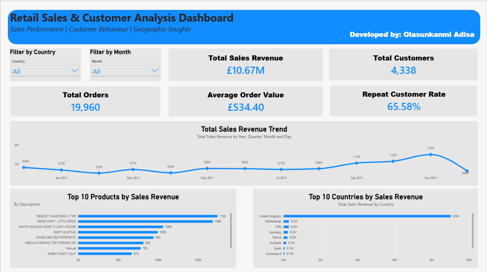

# Retail Sales & Customer Analysis

## Project Overview
Analysed retail transaction data using Python and Power BI to identify sales trends, customer purchasing behaviour and business opportunities.

## Tools Used
- Python (Pandas)
- Google Colab
- Power BI
- Power Query
- DAX

## Key Findings
- **Total Revenue:** £10.67M
- **Total Orders:** 19,960
- **Total Customers:** 4,338
- **Average Order Value:** £534.40
- **Repeat Customer Rate:** 65.58%
- **Best Sales Month:** November 2011 (£1.51M)
- **Top Market:** United Kingdom (£9.03M)

## Dashboard Preview

## Business Recommendations
- Strengthen customer retention through loyalty programmes.
- Prepare inventory for periods of high sales demand.
- Explore opportunities to expand sales outside the UK.

## Author
Olasunkanmi Adisa
